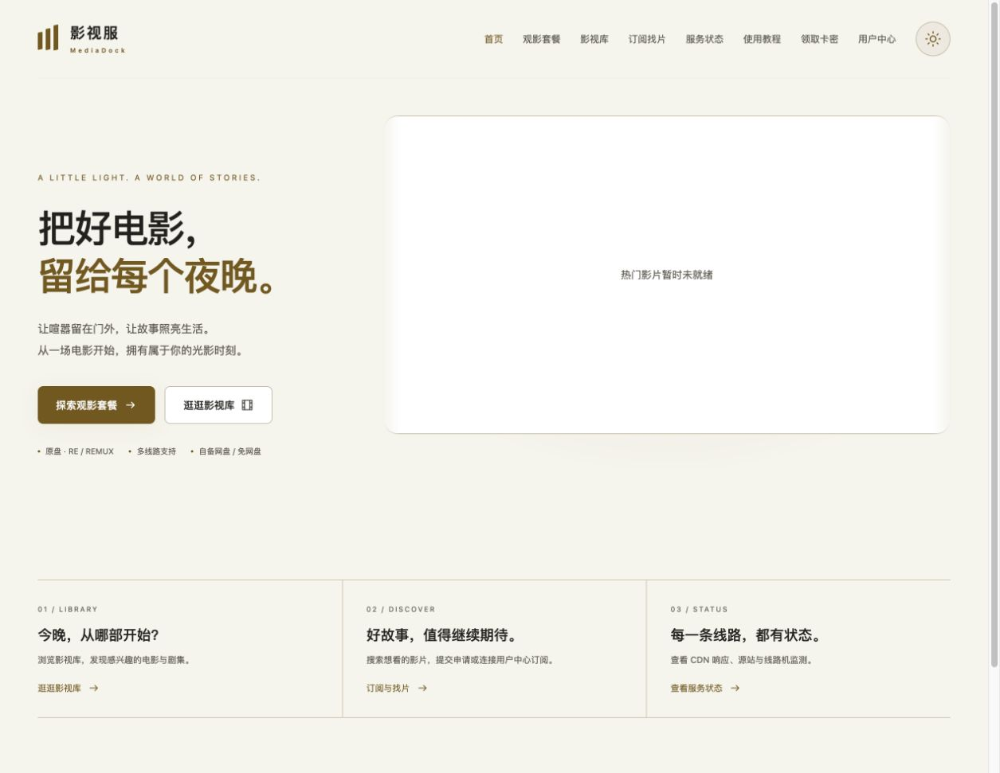
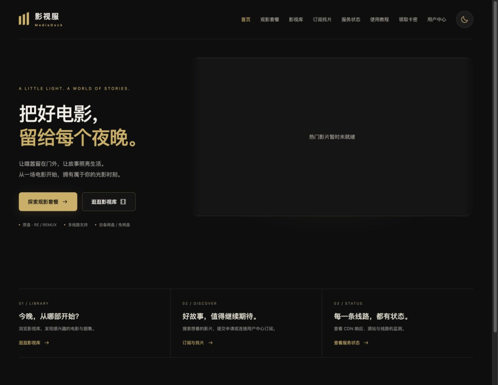
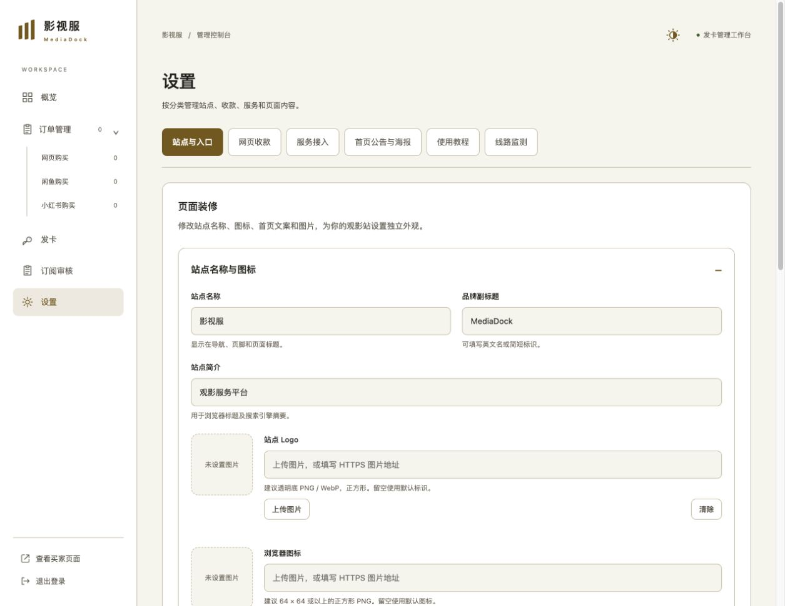
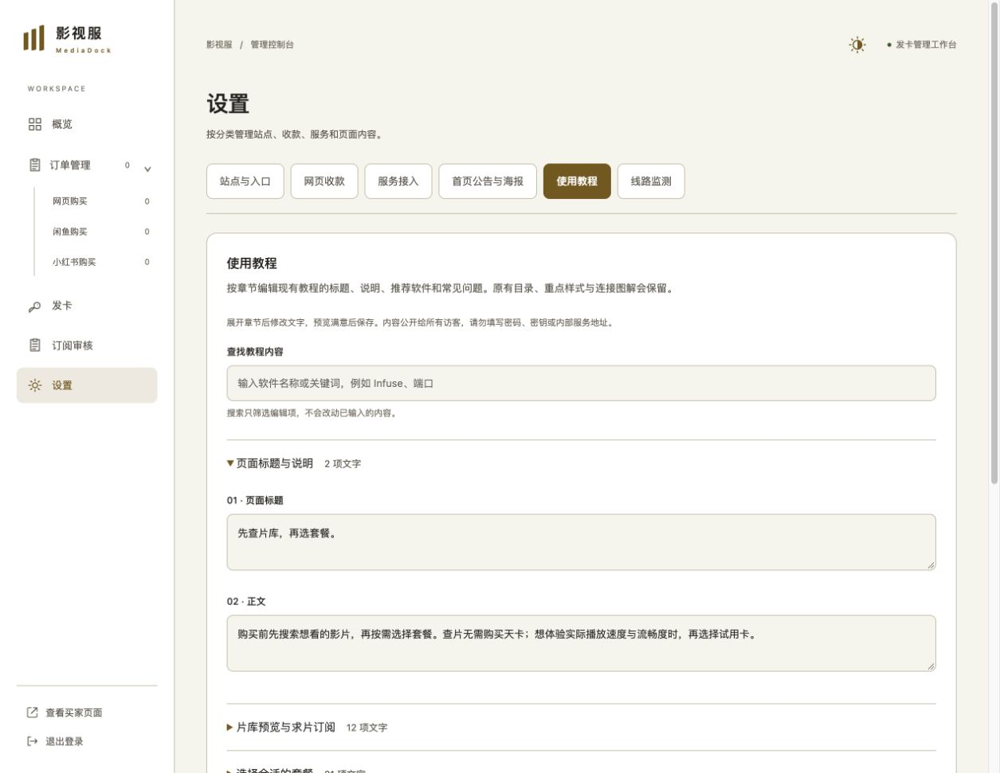

# 影视服 · 观影服务平台

**MediaDock — Self-hosted Media Service Portal**

影视服为自托管媒体服务提供统一的观影门户，集成影视库预览、影片搜索、求片订阅、套餐展示、订单管理和卡密交付。可自定义的站点外观、昼夜主题、公告和使用教程，让用户从了解片库到购买、领取和使用服务，都能在同一个入口完成。

支持对接 Emby、NextEmby、NextFind 和 TMDB，并保留闲鱼、小红书渠道模块。服务地址、域名、Token、平台账号、商品和付款入口均由部署者自行配置。平台不附带影片、媒体服务账号、CDN 或支付渠道。

## 项目定位与反馈

本项目主要用于个人自托管影视服搭建。闲鱼相关能力借鉴了 [Christ9038/Ydisks-Xianyu-Helper](https://github.com/Christ9038/Ydisks-Xianyu-Helper)，并在此基础上加入了页面装修、主题、教程编辑、片库与订单等功能；感谢上游项目的工作，具体许可和来源请见 [NOTICE](NOTICE)。本项目与上游项目没有隶属或官方合作关系。

如果你在自己的部署中遇到问题，或发现功能不好用，可以通过 Telegram 机器人 [@MUGLOWUserBot](https://t.me/MUGLOWUserBot) 联系反馈。请不要在公开 Issue 或聊天中发送站点密码、API Token、订单数据库或其他凭据。

**当前版本：1.1.0 · 已提供可直接安装的 Docker 镜像与安装脚本。**

本仓库公开项目介绍、部署模板及使用说明，**不包含应用源码、账号或业务数据**。应用以容器镜像分发。公开发行页提供可直接导入的镜像与安装脚本，无需 GitHub Token。GHCR 镜像已公开，无需登录即可拉取，镜像地址：

```text
ghcr.io/daidaiya7/mediadock:1.1.0
```

- [下载 v1.1.0 部署资料](https://github.com/daidaiya7/media-dock-release/releases/tag/v1.1.0)
- [配置清单](docs/CONFIGURATION.md) · [使用指南](docs/USAGE.md)
- [使用问题反馈](https://github.com/daidaiya7/media-dock-release/issues) · [Telegram 机器人 @MUGLOWUserBot](https://t.me/MUGLOWUserBot)（请勿发送凭据）

## 项目定位与来源

本项目主要用于搭建和管理自己的媒体服务，适合已经有媒体库、用户中心或相关服务，需要一个统一观影入口的部署者。它不是公共影片资源或托管服务，实际可用内容、账号权限、线路和套餐都由部署者自行配置。

本项目借鉴了 [Christ9038/Ydisks-Xianyu-Helper](https://github.com/Christ9038/Ydisks-Xianyu-Helper)，并在此基础上加入了影视库展示、求片订阅、页面装修、教程编辑、主题切换、订单与卡密交付等功能。上游来源和许可证信息见 [NOTICE](NOTICE) 与 [LICENSE](LICENSE)。

遇到安装、配置或使用问题，可以先提交 [GitHub Issue](https://github.com/daidaiya7/media-dock-release/issues)，也可以联系 Telegram 机器人 [@MUGLOWUserBot](https://t.me/MUGLOWUserBot)。请勿发送密码、Token、卡密、订单数据库、`.env` 或其他敏感信息。

## 1.1.0 更新亮点

这次更新让每位部署者可以直接在后台打造自己的观影门户，同时补齐可用的 Docker 发行镜像。

| 更新 | 使用方式与效果 |
| --- | --- |
| 页面装修 | 在「设置 → 站点与入口」修改站点名称、Logo、浏览器图标、首页文案、页脚与最多 6 张轮播图片 |
| 昼夜主题 | 默认按访客当地时间自动切换；点击半明暗、太阳、月亮图标手动切换并记住选择 |
| 设置分类 | 站点、收款、服务、公告、教程和线路监测分为六个标签，减少长页面查找 |
| 教程编辑 | 按章节修改标题、正文、推荐软件和常见问题，预览后保存；保留连接示意图 |
| 用户中心 | 恢复入口，未配置时给出提示，填写自己的地址后正常跳转 |
| 发行与修复 | 提供 AMD64 / ARM64 镜像、离线安装与校验文件，修复自定义站点名称的 HTML 转义 |

## 界面预览

以下为 1.1.0 脱敏测试站实拍。新安装尚未配置 TMDB 或自定义轮播图片时，首页会显示图片准备提示；接入服务后展示实际内容。

### 白天主题



### 黑金夜间主题



### 分类设置与页面装修



### 使用教程编辑



## 功能

- 影视库封面、搜索、海报与详情预览。
- 求片申请、管理员审核和兼容服务订阅对接。
- 套餐、购买提醒、订单核对及卡密领取。
- 闲鱼与小红书渠道适配，使用部署者自己的账号。
- 页面装修：站名、Logo、浏览器图标、首页文案、轮播图片与页脚。
- 黑金夜间与浅色日间主题，支持按当地时间自动切换及图标手动切换。
- 分类设置、可编辑使用教程、首页公告、简介与热门影片缓存。
- 服务端监测和用户浏览器的 HTTPS 响应时间检测。
- 独立数据卷与凭据卷，便于备份和迁移。

## 快速安装（推荐）

先安装 Docker 与 Docker Compose v2；Windows 的 Docker Desktop 请使用 Linux 容器模式。发行页同时提供 AMD64 与 ARM64 的离线镜像，安装脚本按 Docker 运行架构选择并校验 SHA-256，不需要镜像仓库账号。先把部署 ZIP 解压到固定文件夹（Windows 例如 `C:\MediaDock`），打开该目录的终端。

Linux / macOS：

```sh
sh ./install.sh
```

Windows PowerShell：

```powershell
powershell -ExecutionPolicy Bypass -File .\install.ps1
```

这里的执行策略参数仅对这次 PowerShell 进程生效。脚本下载当前版本的镜像、核对校验值、执行 `docker load`，然后以 `--pull never` 启动服务；不会覆盖已有 `.env` 或清除数据卷。升级已有部署时，先按下方升级说明修改已有 `.env` 的版本号。

也可以在发行页手动下载对应架构的 `.tar.gz`，核对 `SHA256SUMS.txt` 后运行：

```sh
docker load -i mediadock-1.1.0-linux-amd64.tar.gz
# 首次部署才复制；已有 .env 请保留。
[ -f .env ] || cp .env.example .env
docker compose up -d --pull never
```

Apple Silicon / ARM64 主机把文件名中的 `amd64` 换成 `arm64`。

## Docker Compose 拉取部署

GHCR 支持匿名拉取，不需要 GitHub Token。网络无法访问镜像仓库时，可使用上方安装脚本，从 GitHub Release 下载并导入镜像。

安装 Docker 与 Docker Compose v2。镜像支持 `linux/amd64` 和 `linux/arm64`，适用于常见 x86-64 Linux 服务器、ARM64 设备，以及使用 Docker Desktop 的 Intel / Apple Silicon Mac 和 Windows 电脑。Windows 请启用 Linux 容器模式。

下载并解压发行页的部署资料到固定文件夹，例如 Windows 的 `C:\MediaDock`。在包含 `compose.yaml` 的文件夹打开 PowerShell 或终端，再执行以下命令；不要在压缩包预览窗口或临时解压目录内直接编辑和部署。也可以克隆本仓库：

```sh
git clone https://github.com/daidaiya7/media-dock-release.git
cd media-dock-release
```

创建环境配置文件：

| 系统 / 终端 | 命令 |
| --- | --- |
| macOS / Linux | `cp .env.example .env` |
| Windows PowerShell | `Copy-Item .env.example .env` |

镜像地址已填写，无需另找镜像或构建源码。首次部署保留本机访问设置，在 `compose.yaml` 所在目录执行：

```sh
docker compose pull
docker compose up -d
docker compose ps
```

访问 `http://127.0.0.1:59189/admin` 初始化管理员密码。默认用户名为 `admin`，可通过 `MEDIADOCK_ADMIN_USERNAME` 修改；没有通用初始密码。远程服务器可先通过 SSH 隧道初始化：

```sh
ssh -L 59189:127.0.0.1:59189 user@your-server
```

初始化完成后，填写自己的服务及凭据，再开放公网 HTTPS。默认套餐均禁用，需要核对价格、模板和交付方式后再启用。

如需确认拉取的镜像，可单独执行 `docker pull ghcr.io/daidaiya7/mediadock:1.1.0`。若下载失败，先检查 Docker 主机能否连接 `ghcr.io`；下载访问条件与应用的业务服务配置无关。

## 公开访问

在 `.env` 设置自己的公开域名和反向代理 IP：

```dotenv
MEDIADOCK_PUBLIC_BASE_URL=https://media.example.com
MEDIADOCK_REQUIRE_HTTPS=1
MEDIADOCK_TRUSTED_PROXIES=172.18.0.1
MEDIADOCK_NEXTEMBY_URL=https://nextemby.example.com
```

以上域名和代理 IP 均为示例。填写容器实际可访问的 NextEmby 地址；代理 IP 填容器实际看到的连接来源，不要填 `*`。宿主机 Nginx 经 Docker 映射端口连接时，来源通常是 Docker 网络网关，需结合实际部署确认。

配置有效 TLS 证书，并参考 [Nginx 示例](deploy/nginx.conf.example) 配置反向代理，再执行 `docker compose up -d` 应用环境变量。

## 使用与数据

详见 [使用指南](docs/USAGE.md) 和 [配置清单](docs/CONFIGURATION.md)。首次使用请验证自己的完整测试订单，从登记、核对到发卡和领取。

- `mediadock-data` 卷保存数据库、配置和缓存。
- `mediadock-secrets` 卷保存连接凭据和卡密加密密钥。

备份与迁移必须保留两个卷，实际卷名通常带 Compose 项目前缀。不要执行 `docker compose down -v`，它会删除业务数据及密钥。不要把实例的 `.env`、凭据、订单数据库、备份或日志提交到 GitHub。

## 升级到 1.1.0

已有实例先按照 [备份说明](docs/USAGE.md#更新与备份) 保存数据卷与凭据卷，再把 `.env` 中的镜像改为：

```dotenv
MEDIADOCK_IMAGE=ghcr.io/daidaiya7/mediadock:1.1.0
```

使用本次发行的 `compose.yaml`，保留原 Compose 项目名和原有卷名，执行 `docker compose pull` 与 `docker compose up -d`。不要删除原数据卷，也不要用新下载的示例配置覆盖实例中的服务地址和账号设置。v1.0.0 仅发布了部署资料；当时尚未启动应用的用户直接按首次部署步骤安装即可。

## 发行与来源

应用源码仓库保持私有，公开镜像提供可运行应用。本项目不承诺容器或编译程序无法被逆向；镜像持有人仍可分析其中的程序和前端资源。所有服务凭据均由部署者在自己的实例中配置。

应用包含第三方及上游代码，随发行保留其 [许可证](LICENSE) 和 [来源声明](NOTICE)。上游已有的许可权利不因源码仓库私有而取消。
